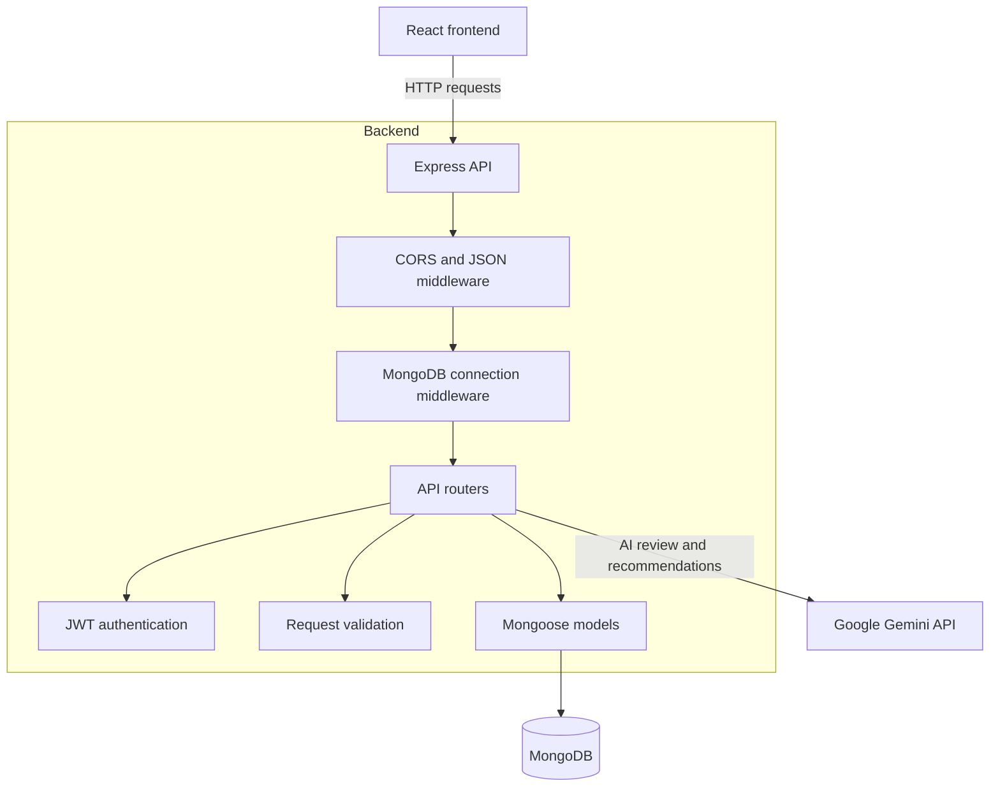

# Internship Application Tracker Backend

[](https://github.com/jashiadeveza/itelect4-backend/actions/workflows/ci.yml)

The backend API for the Internship Application Tracker. It provides authentication, applicant and application management, internship data, and AI-assisted internship reviews and recommendations.

## Live Applications

- **Frontend:** [https://itelect4-project-eight.vercel.app](https://itelect4-project-eight.vercel.app)
- **Backend API:** [https://itelect4-backend-topaz.vercel.app](https://itelect4-backend-topaz.vercel.app)
- **Health check:** [https://itelect4-backend-topaz.vercel.app/api/health](https://itelect4-backend-topaz.vercel.app/api/health)

## Features

- User registration and login with hashed passwords and JWT authentication
- Applicant and application API routes
- Internship listing and management
- AI-powered application reviews and internship recommendations
- MongoDB persistence with Mongoose
- Request validation, error handling, CORS configuration, and rate limiting for AI requests

## Technology

- Node.js and TypeScript
- Express
- MongoDB and Mongoose
- JSON Web Tokens and bcrypt
- Google Gemini API
- Vitest and Supertest

## Architecture



## API Overview

| Route | Purpose |
|---|---|
| `/api/health` | Check API and database connection status |
| `/api/auth/register` | Register a user |
| `/api/auth/login` | Log in and receive a JWT |
| `/api/applicants` | List, view, and create applicants |
| `/api/applications` | List, view, create, update, and delete applications |
| `/api/internships` | List, view, and create internships |
| `/api/ai` | Request an AI application review |
| `/api/ai/recommendations` | Get AI internship recommendations |

## Run Locally

### Prerequisites

- Node.js 22 or later
- npm
- A MongoDB database
- A Google Gemini API key to use the AI endpoints

### Setup

Clone the repository and install dependencies:

```bash
git clone https://github.com/jashiadeveza/itelect4-backend.git
cd itelect4-backend
npm ci
```

Create a `.env` file in the project root:

```env
MONGODB_URI=mongodb+srv://<username>:<password>@<cluster-url>/<database>?retryWrites=true&w=majority
JWT_SECRET=replace-with-a-random-secret-at-least-32-characters
PORT=3000
CORS_ORIGIN=http://localhost:5173,https://itelect4-project-eight.vercel.app
GEMINI_API_KEY=your-gemini-api-key
```

Use your own MongoDB connection string, a random JWT secret with at least 32 characters, and your Gemini API key. Keep `.env` private; do not commit secrets to the repository.

Start the development server:

```bash
npm run dev
```

The API will be available at `http://localhost:3000`. Check `http://localhost:3000/api/health` to verify the server and database status.

## Available Scripts

| Command | Description |
|---|---|
| `npm run dev` | Start the development server with automatic reload |
| `npm run build` | Compile TypeScript into `dist/` |
| `npm start` | Run the compiled server |
| `npm run typecheck` | Type-check the project |
| `npm test` | Run the test suite |
| `npm run seed` | Run the database seed script |
| `npm run try-ai` | Run the AI test script |

## AI Use Disclosure

AI tools were used to assist with development and documentation tasks, including test setup and CI troubleshooting. The project authors are responsible for reviewing and validating the final changes.
